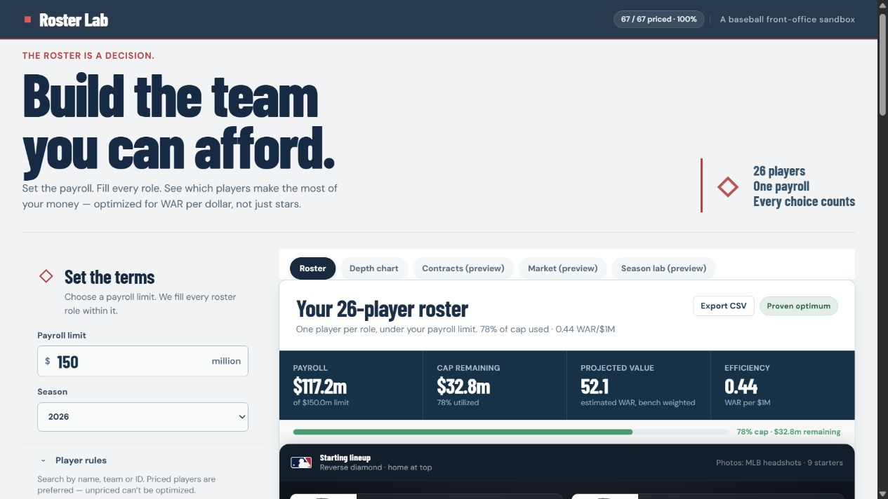

# Roster Lab

[](https://github.com/lushy6/roster-lab/actions/workflows/ci.yml)

**Python · FastAPI · OR-Tools · SQLite · React · TypeScript**



## Quick start: no data download or API key

Requires Python 3.12+ and Node.js 22+. From the repository root:

```sh
python -m venv .venv
# Windows: .venv\Scripts\activate
# macOS/Linux: source .venv/bin/activate
python -m pip install -r backend/requirements.lock
cd backend
python -m uvicorn app.main:app --host 127.0.0.1 --port 8000
```

In another terminal, from the repository root:

```sh
cd frontend
npm ci
npm run dev
```

Open the local URL, choose **Try demo data**, then **Build roster**. Change the payroll limit, lock a player, and compare saved scenarios. Demo players are fictional. Contracts, Market, and Season lab are previews, not completed forecasts.

**Verified October 17, 2026:** 79 backend tests, 14 frontend unit tests, and 7 browser tests passed; lint and production build passed. The tests cover constraints, salary imports, data safety, CSV export, saved scenarios, player locks, error handling, demo exit, and phone-width overflow.

Browser tests support Windows and Unix virtual environments. Set `ROSTER_PYTHON` to a Python executable for another test environment. See Actions for automated checks.

A local MLB front-office simulator. The first playable slice builds a hypothetical 26-player roster under a user-set payroll limit. It keeps player performance and attributed salary inputs separate.

## Development

From `backend`, run `..\.venv\Scripts\python.exe -m uvicorn app.main:app --reload`. From `frontend`, run `npm install` and `npm run dev`. The frontend expects the API on `http://127.0.0.1:8000` (override with `VITE_API_URL`). Python dependencies are pinned in `backend/requirements.lock`.

The API stores everything in `data/roster.db`. Set `ROSTER_DB` to a file path to use a different database, for example when experimenting.

Checks: from `backend`, `..\.venv\Scripts\python.exe -m pytest`. From `frontend`, `npm run lint`, `npm run typecheck`, `npm run test:unit`, and `npm run test:e2e`. The e2e suite starts its own API and UI on ports 8010 and 5183 with a throwaway database, so it never touches your dev servers or `data/roster.db`.

Salary CSV columns: `player_id,season,base_salary_usd,source_url,checked_at,reviewer_note`. `base_salary_usd` stores the annual player salary or payroll figure reported by the cited source. Missing salary excludes a player from optimization. `reviewer_note` is optional and is carried into saved scenario provenance.

Importing a CSV **merges** with the salaries already on file: a player in the CSV replaces their earlier salary and everyone else is kept. Pass `mode=replace` (`POST /api/salaries/import?season=2026&mode=replace`) to swap out the whole register instead. The API keeps the newest three player snapshots and salary registers per season, plus the versions behind your 20 most recent saved scenarios (the ones the UI lists), and deletes older ones. Older scenarios still open, since each carries its own results, but they stop pinning full league snapshots.

**Demo mode** loads fictional players so you can try the app. It refuses to load while live player data exists (the check and the write are one transaction), a live refresh replaces the demo data for its own season, salary import is blocked while it is active, and **Exit demo** (`DELETE /api/demo`) removes it.

The checked-in `data/salary-template-2026.csv` contains the complete 2026 MLB player snapshot used when it was generated, with salary and attribution fields intentionally blank for review. The populated `data/salary-register-2026.csv` is the imported 2026 register used by the local database. It contains 904 unique player salaries matched to MLB Stats API IDs; the remaining live players stay blank until an attributed source row is available.

The 2026 register is sourced from [The Baseball Cube's 2026 payroll snapshot](https://www.thebaseballcube.com/content/payroll_year/2026/), which aggregates opening-day roster salary figures from all 30 clubs. The source is an opening-day payroll snapshot, not an MLB luxury-tax calculation; its treatment of prorated or guaranteed amounts follows the source's roster tables. The register was captured on 2026-09-17. The raw roster-page export is kept in `data/the-baseball-cube-2026-roster.csv` for auditability. It includes repeated traded-player rows; `scripts/import_salaries_2026.py` collapses those rows, joins names to the live MLB player list, and writes the app's salary schema.

To rebuild the register after replacing the raw source export, run `.venv\Scripts\python.exe scripts\import_salaries_2026.py` from the project root. To load a CSV into a running app, use the **Import salary CSV** control or `POST /api/salaries/import?season=2026`.

## Value estimate

Version `war-proxy-v3` is an **approximate WAR-like estimate**, not an official WAR statistic or a validated forecast. It uses only the two seasons before the selected season. The most recent season receives weight 0.65 and the older one 0.35. A season only counts if the player has playing time in it (an empty row is the same as no row). The v3 parser reads innings in baseball's thirds notation (`.1` is one out and `.2` is two outs), or from an `outs` count when present; saved v2 scenarios keep their stored numbers. A player whose only season is last season, such as a rookie, has it weighted fully. A player who missed last season keeps the 0.35 weight on the older one, so he projects at a fraction of a full workload with medium uncertainty rather than a full one. (v1 weighted a missing year as zero playing time, which understated rookies; saved v1 scenarios keep their original numbers.) OPS regresses toward .720 over 200 plate appearances; ERA regresses toward 4.20 over 50 innings. Projected playing time is the weighted prior playing time, capped at 650 plate appearances or 200 innings. The hitting estimate converts the OPS difference into runs using `(OPS - .720) × PA / 4`, then adds 2 replacement wins per 600 PA and a position adjustment. The pitching estimate uses `(4.20 - ERA) × IP / 9` runs and 2 replacement wins per 180 IP. Ten runs equal one win. It omits defense, park effects, detailed baserunning, and injury forecasts; the app exposes those limits with each result. Two-way estimates add hitting and pitching value once each.


## Roster value

The optimizer maximizes **slot-weighted** WAR under the payroll limit. Lineup, rotation and bullpen slots count a player's full estimate. The backup catcher (`C2`) and the three bench slots (`BN1`–`BN3`) count 25% of it, roughly a bench bat's share of a starter's plate appearances, so the optimizer no longer parks a star on the bench at full value. Each pick shows its own estimate, and `Pick.weight` and the CSV export's `slot_weight` and `counted_war` columns show what counted. The weights are assumptions, not measurements; change them per scenario with `RosterRules(slot_weights={...})`.

Position eligibility can still put a bench player above a weaker starter: the best remaining hitter may simply not be able to play the scarce position.

If the solver runs out of time (15 seconds per solve) before finding any roster, the API returns 503 `solver_timeout`. That is different from a payroll limit that is genuinely too low, which returns 422 with the cheapest valid payroll. If player or salary data is replaced and pruned while a build is solving (for example by a refresh in another tab), the build returns 409 `data_changed` instead of saving a scenario that points at data that no longer exists; build again.

## Preview tabs

Contracts, Market and Season lab are placeholders and are labelled "preview" in the UI. Contracts repeats the 2026 salary for later years, Market only reports cap room, and Season lab draws a band whose width you pick with a slider; none of them is derived from contract, transaction, playing-time or injury data.
